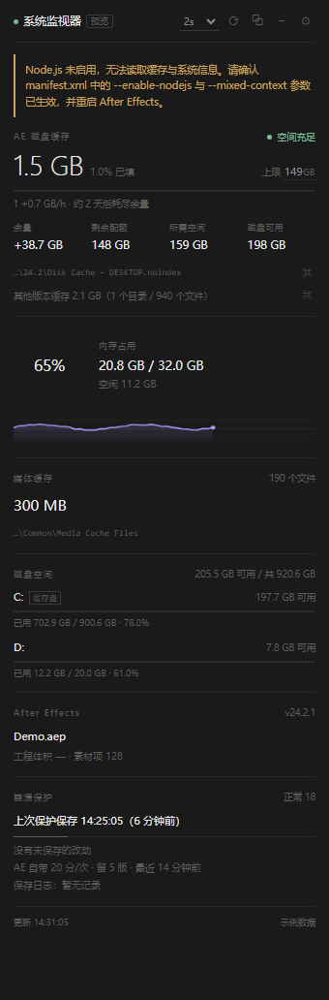
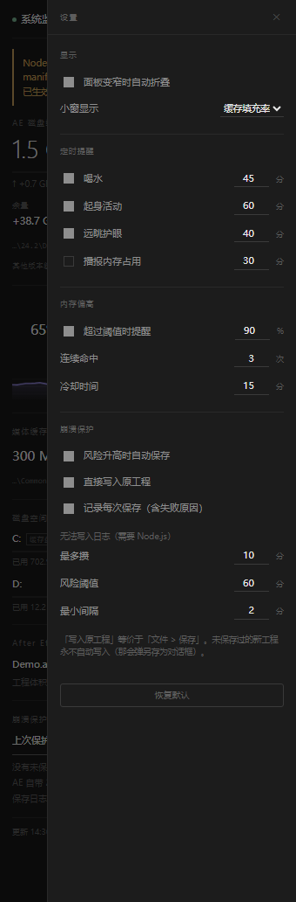

# AE System Monitor

[](https://github.com/Aili-1234/ae-system-monitor/actions/workflows/tests.yml)
[](https://github.com/Aili-1234/ae-system-monitor/releases)
[](LICENSE)

**一个塞进 After Effects 的磁盘缓存监控面板。** 它只回答三个问题：缓存配额还够不够、照现在的增速几天后撞线、撞线前能不能先替你存一次盘。

不是独立软件——CEP 扩展，装完出现在 AE 的 `窗口 > 扩展 > System Monitor`，随 AE 开关。



> [!IMPORTANT]
> **不需要 Node.js，不需要任何前置插件，不需要关闭 AE 的任何安全选项。** 只需要 AE CC 2017 及以上，加上给未签名面板打开 `PlayerDebugMode`（`install.bat` 会替你开）。

---

## 它能告诉你什么

| 这格 | 意思 | 为什么普通任务管理器答不了 |
|---|---|---|
| 已用 / 上限 | AE 磁盘缓存现在占多少、配额多少（配额从 AE 首选项读，没有公开 API） | 配额根本不暴露给外部工具 |
| **余量** | 磁盘可用 −（上限 + 10 GB 安全垫），**负数就是 AE 会弹"磁盘空间不足"的那一刻** | 要"磁盘剩 197 GB − 缓存 149 GB"，没人替你做这个减法 |
| 增速 / 还能撑多久 | 按最近 2 小时真实增速推算几天后撞线 | 任务管理器只有当下快照 |
| 其他版本缓存 | 机器上别的 AE 版本各占多少 | 要自己去找 `Disk Cache - *.noindex` |
| 内存 | AE 进程内存与曲线 | 有，但看不到"趋势" |
| 崩溃保护 | 内存飙升 / 余量转负 / 改动久未保存时静默存一次盘 | AE 自带自动保存是固定 20 分钟，不看你是不是在渲染 |

<details>
<summary>设置抽屉长这样</summary>



</details>

## 安装

### 方式一：双击安装（Windows）

下载 [Releases](https://github.com/Aili-1234/ae-system-monitor/releases) 里的 zip，解压后双击 `install.bat`，然后**完全退出 AE 再重开**。

### 方式二：git clone 到扩展目录（可 `git pull` 更新）

```bat
cd "%APPDATA%\Adobe\CEP\extensions"
git clone https://github.com/Aili-1234/ae-system-monitor.git AESystemMonitor
```

然后注册表 `HKEY_CURRENT_USER\Software\Adobe\CSXS.11` 新建字符串 `PlayerDebugMode` = `1`（不确定 CEP 版本就把 `CSXS.6`~`CSXS.12` 都写一遍）。重开 AE。

### 方式三：手动复制

1. 整个文件夹复制到 `%APPDATA%\Adobe\CEP\extensions\AESystemMonitor`（`index.html` 必须在这一层）；
2. 同上写 `PlayerDebugMode`；
3. 完全退出并重开 AE。

三种方式的详细步骤、卸载、常见问题见 [docs/install-zh.md](docs/install-zh.md)。

## 隐私

- **不联网。** 全仓库没有任何 HTTP 请求、遥测或更新检查（`grep -r "http" js/` 可自查）。
- **只读**：AE 首选项文件（拿缓存上限）、缓存目录里各文件的大小、系统内存与磁盘可用量。
- **只写**：面板自身配置（`localStorage`）、保存日志 `%LOCALAPPDATA%\AESystemMonitor\saves.log`、以及你开自动保存时由 AE 写出的工程副本。
- 不需要"允许脚本写入文件和访问网络"这个 AE 安全选项——ExtendScript 侧只调用 `app.version`、`app.project.*`、`app.project.renderQueue.rendering`。

## 它做不到什么

- **AE 崩了它一起消失**，没有"崩后抢救"。
- 没有"即将崩溃"的 API，只能靠内存 / 余量 / 未保存改动这类统计信号提前一步。
- **面板关掉就不保护**（可以折成 96×132 的窄条，一直挂着）。

## 环境要求

| 项 | 要求 |
|---|---|
| 宿主 | After Effects CC 2017 (14.0) 及以上（manifest: `AEFT [14.0,99.9]`） |
| 运行时 | CEP 7.0+（`RequiredRuntime CSXS 7.0`），Node 集成由面板自己的 manifest 打开 |
| 系统 | Windows（macOS 有对应分支，未实测） |
| 依赖 | 无。无 node_modules、无 package.json、无构建步骤 |

## 刷新节奏（为什么它不吵）

| 状态 | 间隔 |
|---|---|
| 空转 | 3 秒 |
| AE 正在渲染 | 12 秒（心跳超时同时缩到 1.5 秒） |
| 面板不可见 | 30 秒 |
| 磁盘读数 | 30 秒取一次，失败时保留上次有效值并标"读数过期" |
| 数值未变 | 不重绘 |

## 开发与测试

```bat
for %f in (tests\*.test.js) do node %f
```

11 组、429 项断言。其中 `optimize.test.js` 专门守着本次优化的四条路径（`fs.statfsSync` 优先、日志可关、其余降级链、`[hidden]` 不被作者样式盖掉）。

**测试与「这台机器有没有装 AE」无关**：`tests/_fixture.js` 会临时造一份假 AE 环境（偏好文件、自动保存目录、缓存树），所以任何机器、任何 Node 版本跑出来的数字都一致。这也正是 CI 能在干净的 runner 上变绿的原因。

CI 在 GitHub Actions 上跑，Windows 是硬门禁、Linux 分支跑但不阻断：

```bat
bash tools/ci-local.sh
```

## 结构

```
index.html            面板骨架（60+ 元素 ID）
css/style.css         视觉（固定深色，只靠 1px 细线与状态色）
js/main.js            展示与调度（唯一胶水层）
js/ae-cache.js        偏好解析、路径解码、缓存目录定位与体积扫描
js/settings.js        默认值与 schema 校验（脏数据归一化）
js/reminder.js        定时提醒（喝水/起身/远眺），渲染时自动静音
js/guard.js           崩溃风险判定与六道安全闸
js/trend.js           增速估算、样本窗口、ETA
jsx/host.jsx          ExtendScript：版本 / 工程状态 / 静默保存
CSXS/manifest.xml     CEP 注册
tests/                回归测试，不随扩展加载
```

## 许可

[MIT](LICENSE)
