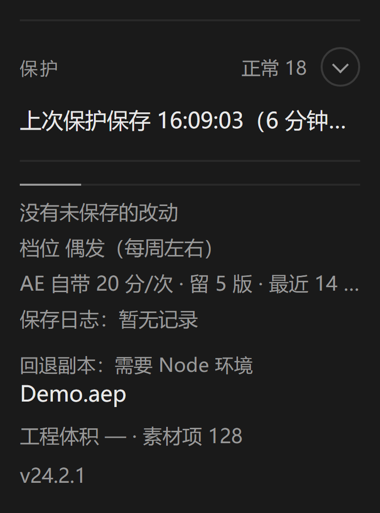
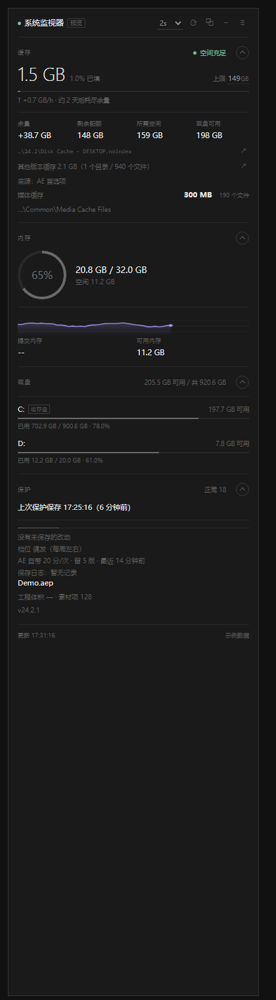

# AE System Monitor

[](https://github.com/Aili-1234/ae-system-monitor/actions/workflows/tests.yml)
[](https://github.com/Aili-1234/ae-system-monitor/releases)
[](LICENSE)

停靠在 After Effects 面板区里的资源监视器。核心回答一个问题：

> **AE 的内置磁盘缓存，现在占了多少、还要吃掉多少、这块盘撑得住吗？**

---

## 一、它显示什么

首屏只有**四个主项**（缓存 / 内存 / 磁盘 / 保护），细节默认收起 —— 面板通常被塞进很窄的侧栏，
一上来铺满参数反而看不出重点。每张卡右上角一个圆形展开键，展开状态会被记住。

**首屏视图可以改**（设置 › 显示 › 首屏视图）：

| 选项 | 效果 |
|---|---|
| **极简** | 只显示四个主项的结论，细节收起（默认） |
| **完整** | 一打开就把参数全铺开 |
| **沿用上次** | 记住你上次的展开状态 |

改完立即生效，不用重启面板。

 


```
┌──────────────────────────────────────┐
│ ● 系统监视器            2s  ⟳  ≡  −  │
├──────────────────────────────────────┤
│ 缓存                    ● 空间充足  ⌃ │
│  1.5 GB  1.0% 已填     上限 149 GB   │
│  ███░░░░░░░░░░░░░░░░░░░░░░░░░░░░     │
│  ↑ +0.7 GB/h · 约 2 天后耗尽余量     │
├──────────────────────────────────────┤
│ 内存                               ⌄ │
│   ╭─────╮   20.8 GB / 32.0 GB        │
│   │ 65% │   空闲 11.2 GB             │
│   ╰─────╯                            │
├──────────────────────────────────────┤
│ 磁盘            205.5 GB 可用 / 920 GB│
├──────────────────────────────────────┤
│ 保护                       正常 18  ⌄ │
│  上次保护保存 17:23（6 分钟前）      │
└──────────────────────────────────────┘
```

### 三个关键数字怎么来的

| 指标       | 含义                        | 来源                       |
| -------- | ------------------------- | ------------------------ |
| **已用**   | 缓存目录里 `.aecache` 文件的真实总大小 | 递归扫描缓存目录                 |
| **上限**   | 首选项里「最大磁盘缓存大小」            | AE 偏好文件 `Max Size 3`     |
| **所需空间** | 上限 + 安全缓冲                 | Adobe 规则：可用空间须比上限多 10 GB |

### 结论判定（本插件最有用的部分）

Adobe 的行事规则是：**缓存盘可用空间 ≥ 缓存上限 + 10 GB**，否则 AE 在打开工程或预览时提示磁盘空间不足。

| 结论      | 条件                | 说明             |
| ------- | ----------------- | -------------- |
| 🟢 空间充足 | 可用 ≥ 上限 + 缓冲      | 缓存能长到上限        |
| 🟡 空间偏紧 | 上限 ≤ 可用 < 上限 + 缓冲 | AE 可能弹「磁盘空间不足」 |
| 🔴 空间不足 | 可用 < 上限           | 缓存永远写不满，上限形同虚设 |

真实例子：上限 149 GB、缓冲 10 GB、C 盘可用 197.7 GB → 197.7 ≥ 159 → 🟢 充足。

### 缓存增速与「还能撑多久」

`已用 5.9 GB` 只描述此刻。真正有用的是趋势，所以进度条下面还有一行小字：

```
↑ +1.2 GB/h · 约 3 天后耗尽余量
```

- 按**最近 2 小时**的采样估算，每分钟最多记一个点，样本不足 10 分钟就显示「采样中」，不编造结论
- 缓存被 AE 自己清理时会显示 `缓存回落 −0.8 GB/h`，不会拿负数去算 ETA
- 采样点存在 `localStorage` 里，关掉面板再打开不用重新积累
- 耗尽 24 小时以内会标黄

> 快照数据存在 `localStorage`，隐私上没有任何外发。

---

## 二、安装

1. 双击 `install.bat`
2. **完全退出 AE**（含后台进程）后重新打开
3. `窗口` → `扩展` → **System Monitor**，拖到右侧停靠

脚本会把扩展复制到 `%APPDATA%\Adobe\CEP\extensions\AESystemMonitor`，
  
并给 CSXS 9~12 全部写入 `PlayerDebugMode=1`（未签名扩展必需）。

**卸载**：双击 `uninstall.bat`，重启 AE。

---

## 三、数据从哪来（实测记录）

这部分是踩坑踩出来的，写下来省你重走一遍。

### 1. 偏好文件路径

```
%APPDATA%\Adobe\After Effects\<版本>\Adobe After Effects <版本> 设置.txt
```

**坑一**：英文版叫 `Prefs.txt`，中文版叫 `设置.txt`，德/法/日版又不一样。
  
所以插件**不靠文件名**，而是读文件内容找节标记 `["Disk Cache Controls"]` —— 任何语言都能命中。

### 2. 键名

```ini
["Disk Cache Controls"]
	"Enabled 2"  = "1"
	"Folder 7"   = "C:\Users\"E69D8E"\AppData\Local\Temp"
	"Max Size 3" = "149"

["Additional Disk Cache Controls"]
	"Minimum Volume Free Space (Gigabytes)" = "10"
```

**坑二**：`"E69D8E"` 不是乱码。AE 把路径里的非 ASCII 字符转成了十六进制字节，
  
`E6 9D 8E` 正是「李」的 UTF-8 编码。插件会还原成 `C:\Users\李\AppData\Local\Temp`。
  
如果直接把这串当路径用，永远找不到缓存目录 —— 这大概正是很多同类工具翻车的地方。

**坑三**：`Folder 7` 的值里自带引号，用普通正则 `"([^"]*)"` 会在 `\"` 处截断。
  
必须按行取值、再剥外层引号。

### 3. 缓存实体目录

```
<Folder>\Adobe\After Effects\<版本>\Disk Cache - <主机名>.noindex
```

偏好里只写了基准目录（默认是 `Temp`），AE 自己再往下建三层。
  
插件优先拼路径，拼不中就在基准目录下搜 `Disk Cache - *.noindex` 兜底。

### 4. 实测样本（本机 AE 2024）

| 项      | 值                                                                    |
| ------ | -------------------------------------------------------------------- |
| 上限     | 149 GB（AE 2023 为 115 GB）                                             |
| 缓存目录   | `Temp\Adobe\After Effects\24.2\Disk Cache - DESKTOP-7NDPQ5U.noindex` |
| 当前占用   | 1.47 GB / 608 个 `.aecache`                                           |
| 共享媒体缓存 | 300 MB / 190 个文件                                                     |

---

## 四、几个已知边界（不藏着）

**上限单位按 GB 解读。** `Max Size 3 = 149` 我按 GB 处理，与 AE 首选项界面单位一致。
  
若你的环境显示明显不对，点一下上限数字可手动改，会记住（存进面板设置 `sysmon.cfg.quotaGB`，范围 1–4000 GB）。
  
悬浮在数字上能看到真实来源（AE 首选项 / 手动设定 / Adobe 默认公式）。

**偏好文件是 AE 保存时才写的。** 在 AE 里改了上限但没关掉 AE 之前，面板读到的可能还是旧值。
  
想立刻生效：AE 里 `首选项 → 确定`（触发写入），再点面板刷新。

**扫描有成本。** 缓存目录可能堆到几十 GB、几万个文件，所以：

- 扫描走异步 + 并发 8 + 30 秒硬超时，不会卡界面
- 结果缓存 25 秒（媒体缓存 120 秒），自动刷新时复用
- 想强制重扫，点 `⟳`

**多版本共存时**主数字显示 AE 当前运行的版本对应的缓存目录；
  
下面另有一行「其他版本缓存」把同一个盘上**旧版本**的 `Disk Cache - *.noindex` 合计出来（1.4.0 新增），
  
点旁边的 `📂` 直接跳过去 —— 这些旧目录 AE 不会自动清理，常年占着几个 GB 到几十 GB。
  
AE 没开时（面板独立打开），退到版本号最高的那份偏好设置。

**只提示，绝不删东西。** 面板没有、也不会有清缓存按钮 —— 清缓存请用
  
AE 自己的 `编辑 → 清理 → 全部内存和磁盘缓存`，那里会同时维护缓存数据库，
  
直接删文件反而容易留下不一致状态。`📂` 只是帮你打开文件夹看一眼。

---

## 五、常见问题

**菜单里找不到 System Monitor**
  
AE 没退干净，或 `PlayerDebugMode` 没写上。查注册表 `HKEY_CURRENT_USER\Software\Adobe\CSXS.11`
  
（AE 2024/2025 是 CSXS.12）是否有 `PlayerDebugMode = 1`。

**上限显示 `--`、路径显示"未找到 AE 偏好设置"**
  
没读到偏好文件。手动在 AE 里打开一次 `首选项 → 媒体和磁盘缓存` 并确定，让 AE 写一次文件。

**磁盘可用显示 `--`**
  
三种可能：CEF 里没有 Node（面板以只读方式打开）、`fs.statfsSync` 在该 Node 上不可用且 PowerShell 也被拦、
  
或那个盘已经不在了。1.4.0 起失败会**保留上一次的有效读数**并标「读数过期 xx 秒前」，
  
而不是把余量直接变成 `--`。想立刻重试：点 `⟳`。

**已用一直是 0 B**
  
AE 关掉后缓存可能被清空过，或定位到了空目录。点 `📂` 确认里面有 `.aecache` 文件。

---

## 六、文件结构

```
AESystemMonitor/
├── CSXS/manifest.xml     注册为 AE 面板，声明 --enable-nodejs / --mixed-context
├── index.html            面板骨架
├── css/style.css         深色主题
├── js/ae-cache.js        缓存探测内核（纯逻辑，可单测）
├── js/settings.js        设置归一化
├── js/reminder.js        提醒调度
├── js/guard.js           崩溃保护判定（纯逻辑，可单测）
├── js/trend.js           缓存增速与「还能撑多久」（纯逻辑，可单测）
├── js/main.js            展示与调度
├── jsx/host.jsx          ExtendScript 端：工程状态 / 静默保存
├── tests/                回归测试
├── install.bat
└── uninstall.bat
```

`ae-cache.js`、`guard.js`、`settings.js`、`reminder.js` 与 DOM 完全解耦，可以直接在 Node 里跑测试：

```js
const AECache = require('./js/ae-cache.js');
const AE = AECache.create({ fs, os, path, Buffer });
console.log(AE.loadPrefs());          // 上限 / 路径 / 缓冲
console.log(AE.loadAutoSavePrefs());  // AE 自带自动保存的间隔与目录
console.log(AE.resolveCacheDir(...)); // 真实缓存目录
```

当前状态：`tests/` 下有十九组回归测试，共 **1089 项**断言全绿；换一台没装 AE 的机器跑（如 CI runner），数字完全一致。

其中第 18 组 `ui-interaction.test.js` 会用纯 Node 造一个最小 DOM，**真的去点提示框上的按钮** ——
因为 1.5.0 出现过「按钮渲染得出来却永远点不动」而当时 660 项断言全绿的 bug（CSS 的 `pointer-events` 没恢复）。1.6.0 已修；
1.6.1 又修了一个同类的：「按预设填入」按钮沿用方形图标按钮的 17×17 尺寸，五个汉字换成 5 行、竖向溢出 34px 压住旁边的说明文字。
1.6.2 补的是"能不能挑"：回退副本从"只有最近一份"变成**按时间列出最近 3 份、逐份取回**；小窗（极简模式）圆环下面也加了一行
**缓存占用（左）/ 内存占用（右）**。

```bash
node tests/umd.test.js            # 11 项：模块在 CEP / 浏览器 / Node 三种环境下都能被取到
node tests/scan.test.js           # 12 项：扫描结果与独立实现逐字节比对，含老 Node 降级路径
node tests/settings.test.js       # 37 项：脏数据归一化、数值裁剪、自定义分钟不被吸附
node tests/reminder.test.js       # 50 项：间隔边界、关闭再开启、稍后提醒、阈值判定、渲染静音不补响
node tests/guard.test.js          # 50 项：风险分级、两种触发、冷却、渲染跳过、写盘风暴防护
node tests/guard-crash.test.js    # 41 项：提交内存信号、崩溃史→不稳定期、有效阈值下限保护
node tests/trend.test.js          # 40 项：增速估算、窗口裁剪、缓存回落、样本不足不给结论
node tests/trend-margin.test.js   # 41 项：双字段采样，ETA 用余量斜率、缓存斜率只解释成因
node tests/autosave.test.js       # 19 项：读取 AE 自带自动保存配置（fixture 偏好文件）
node tests/hostjsx.test.js        # 39 项：用假的 AE 对象真跑 ExtendScript，验证属性名与降级
node tests/compat.test.js         # 21 项：四种老版本 Node 环境下的读取与扫描一致性
node tests/prefs-version.test.js  # 32 项：偏好按运行版本对齐，缓存目录不跨版本兜底
node tests/crash-history.test.js  # 40 项：从 WER 读崩溃史（次数/中位间隔/异常代码，UTF-16LE 解码）
node tests/guard-modes.test.js    # 46 项：四个档位的自动推荐、预设数值与崩溃窗口
node tests/wiring.test.js         # 94 项：ID 接线、脚本顺序、label 指向、声音是否彻底移除
node tests/optimize.test.js       # 57 项：上限/日志开关进 schema、其他版本缓存枚举、降频路径没被退回
node tests/backup.test.js         # 30 项：回退副本命名、按路径哈希分夹、轮转保留份数、挑最新
```

`scan.test.js` 用**独立递归实现**算出基准值再对比，不使用硬编码数字，
  
所以缓存增长时不会误报。

`hostjsx.test.js` 会从 `main.js` 里把内联的 JSX 字符串取出来，用 `new Function` 配一个假的
  
`app` 对象真跑一遍。ExtendScript 里属性名拼错不会报语法错，只会默默返回 `undefined`，
  
这类错误只能靠这种测试拦住。

---

## 六点五、踩过的坑（改代码前请先读）

### 坑 1 · 二选一 UMD 在 CEP 里会失效

`ae-cache.js` 最初写成标准 UMD：

```js
if (typeof module === 'object' && module.exports) module.exports = factory();
else root.AECache = factory();          // ← 面板永远走不到这里
```

在浏览器里没问题，但面板开了 `--enable-nodejs + --mixed-context` 之后，
  
**CEP 会把 Node 的 `module` 注入页面上下文**，`typeof module === 'object'` 成立，
  
于是只写 `module.exports`、从不写 `window.AECache`。
  
结果是面板顶部报「缓存探测模块未加载」，而内存读数却一切正常 ——
  
因为内存走的是 `os`，不依赖这个模块。

正确写法是**两条通道都写**，不要二选一。
  
`tests/umd.test.js` 场景 A 专门复现这个条件（沙盒里同时放 `window` 和 `module`）。

### 坑 2 · 别假设宿主 Node 有 `fs.promises`

CEP 内置的 Node 版本随 AE / Premiere 版本变化，老版本可能没有 `fs.promises`，
  
或 `readdir` 不支持 `withFileTypes`。扫描因此会**静默返回 0** ——
  
不报错、界面显示 0 B，比崩溃更难查。
  
已加降级包装（`cbPromisify` + `listing()`），`tests/scan.test.js` 场景 2 用伪造的老 fs 验证。

### 坑 3 · `.bat` 必须是 CRLF，而测试永远发现不了

Windows 的 `cmd.exe` 解析 **LF-only** 的批处理会串行：脚本一闪而过、
报"命令语法不正确"，甚至把 `Installer` 拆成 `taller` 这种怪错。

1089 项测试**从不执行 `.bat`**，所以这个问题在测试里完全不可见，只在双击安装时才炸。

- 仓库里有 `.gitattributes` 声明 `*.bat text eol=crlf`，正常克隆会得到 CRLF。
- 但 **GitHub 的「Download ZIP」不做 eol 转换**，从网页下载的源码包里 `.bat` 仍是 LF。
  → 所以分发请优先用 Release 里预打包的安装 zip，别让用户自己去下载源码包解压。
- 本地若被编辑器改成 LF，用这条修回：
  `python -c "p='install.bat';b=open(p,'rb').read();open(p,'wb').write(b.replace(b'\r\n',b'\n').replace(b'\n',b'\r\n'))"`

---

## 七、折叠小窗与提醒

### 折叠：把面板压成一个圆环

```
┌──────────┐              点圆环 / ⤢ → 展开
│   74%    │  ← 当前指标（缓存填充率 或 内存占用）
│   缓存   │
│   ⤢  ⚙   │
└──────────┘
```

两种进入方式：

1. 点顶栏的 `−`
2. **面板拖窄到 190px 以下自动折叠**（可在设置里关掉）；再拖宽自动还原

配套把 manifest 的 `MinSize` 降到 `96 × 132`，否则 AE 不允许面板收缩到能放下圆环的尺寸。
  
折叠状态会记住，下次打开 AE 保持原样。

> **做不到的事**：CEP 面板是 AE 的停靠面板，没法悬浮在 AE 窗口之外、也没法贴到屏幕边缘。
>   
> 想要那种效果只能写独立的托盘/悬浮窗程序，与「装在 AE 里」不可兼得。
>   
> 现在的方案是「面板区内最省空间」的做法。

### 提醒：只出现在面板里，不发声

| 提醒     | 默认   | 说明                     |
| ------ | ---- | ---------------------- |
| 喝水     | 45 分 |                        |
| 起身活动   | 60 分 |                        |
| 远眺护眼   | 40 分 | 20-20-20 法则            |
| 播报内存占用 | 关    | 定时把内存百分比报一遍            |
| 内存偏高   | 90%  | 连续 3 次超过阈值才提醒，冷却 15 分钟 |

- **时间全部自己填**，不是固定档位。填 37 就是 37 分钟，不会吸附成 45。
    
  合法区间 5–240 分，超出会被裁剪并回填到输入框，你能看见它改成了什么。
- **全程静音**：没有任何声音。提醒以底部细条呈现，折叠时圆环会轻微呼吸。
- 每条提醒可「稍后 10 分」或「知道了」；小窗里缩成「稍后 / 关闭」，按钮不会被挤出面板。同一条不会重复堆积。
- 关闭某条提醒后再打开，计时**从此刻重新开始**，不会因为关了三天一开就连响。

### 渲染时不打扰

渲染期间顶栏会出现 `渲染中 · 静音` 标记，所有提醒都不弹。

关键在实现方式：**引擎照常走完计时，只是不展示**。这样渲染两小时结束后不会一次性补响一串；
  
每类提醒的下一个周期从它本该到点的时刻继续，结束时会提示一次「渲染结束 · 提醒已恢复（期间静音 2 条）」。

> 这条行为有测试守着（`reminder.test.js` 第 12 组）：2 小时渲染期间静音 2 条，结束后不连响。
>   
> 顺带一提，这条测试最初写错了 —— 忘了推进假时钟，断言恒真等于没测。修正后才真正验证到行为。

### 余量：最该看的那个数字

原来显示「剩余配额」（上限 − 已用），但它不回答真正的问题。
  
现在第一列是 **余量 = 磁盘可用 − (上限 + 缓冲)**：

- `+37.9 GB` → 距离 AE 提示磁盘不足还有 37.9 GB
- `−8.2 GB` → 已经是负数，AE 很快会报警（红色）

---

## 七点五、崩溃保护

### 它做不到什么（先说清）

面板进程和 AE 同生共死。AE 崩了，面板一起消失 —— **不存在"崩溃后抢救"，只有"崩溃前"**。
  
AE 也不提供任何"即将崩溃"的 API，所以这里的判定是**概率推断**，不是预警。

### 判定依据

| 信号             | 权重 | 严重度  |
| -------------- | -- | ---- |
| 内存 ≥ 92%       | 45 | 直接高危 |
| 内存 ≥ 85%       | 28 | 至少留意 |
| 磁盘余量 < 0       | 40 | 直接高危 |
| AE 连续 2 次心跳无响应 | 30 | 至少留意 |
| 缓存配额填满 ≥ 95%   | 10 | 至少留意 |
| 有改动且积压超时       | 10 | —    |

分数与"严重度"分开算：只算加权总分会出现"内存 93% 权重 45、达不到 60、于是判成留意"的矛盾，
  
所以某些单一高危信号会直接拉高等级。

### 什么时候动手

- 风险 ≥ 阈值（默认 60）→ 立即存
- 有改动积压 ≥ 设定时长（默认 10 分钟）→ 存一次
- 距上次保存不足 2 分钟 → 不动

### 六道安全闸

工程没打开 / **工程没保存过（会弹另存为对话框）** / 没有未保存改动 / 正在渲染 / 冷却中 / 总开关关闭
  
—— 任一命中就不写盘。未命名工程绝不自动保存：`save()` 在那种情况下会弹出对话框，
  
自动弹窗打断用户手上的操作，比不保存更糟。

关掉「直接写入原工程」后，它只报警不动手。

### 它到底替你存过没有：看日志

每次自动保存（**成功与失败都算**）都会追加一行到：

```
%LOCALAPPDATA%\AESystemMonitor\saves.log
```

```
2026-10-25 15:02:11 | OK | 风险升高 | 1855ms | 成功 | D:\工作\片头.aep
```

面板的崩溃保护区会显示「最近保存 14:02:11 ✓ · 15:31:07 ✗」，鼠标悬停看每条的原因、
  
耗时与失败原因；设置 › 崩溃保护 里有 **记录每次保存** 开关（默认开），
  
旁边直接写着日志文件的完整路径和一个「打开目录」按钮 —— 不用猜它在哪。

日志超过 512 KB 会自动只留最后 400 行，不会慢慢变成一个负担。
  
写日志失败（权限/磁盘满）不会影响保存本身，静默跳过。

### dirty 怎么来的

`app.project.dirty` 是 AE 17.5（CC2020）起才有、且**官方未文档化**的属性。
  
取不到时用 `app.project.revision`（每次操作 +1）兜底；两种都拿不到就显示"无法确认"，绝不盲目写入。

### 顺带读到了 AE 自己的自动保存配置

```
["Auto Save"]   在 <ver>\*indep-general.txt 里，不在主偏好文件中
  Auto Save Interval      = 20        ← 20 分钟
  Max Project Vers        = 5
  Enable Auto Save3       = 1
```


```

面板会把它一起显示出来。本机实测自动保存目录 `Documents\Adobe\After Effects` **尚不存在**
—— 说明从未真正触发过自动保存，这本身就是有用的信息。

> 建议把面板停靠成常驻窄条，而不是折叠进标签组：Chromium 会节流隐藏标签的定时器。

### 它有多吵（刷新节奏，1.4.0 调整）

| 情况 | 间隔 | 为什么 |
|---|---|---|
| 常态（你在看） | 你设的值，默认 3 秒 | 缓存体积变化本来就慢，够用 |
| AE 正在渲染 | 12 秒 | 渲染时 AE 主线程紧张，跟它抢 `evalScript` 只会互相拖慢 |
| 面板不可见 | 30 秒 | 没人看这些数；切回前台立刻补一次 |
| 每次刷新 | 磁盘读数只 30 秒取一次 | 优先 `fs.statfsSync`（进程内，无子进程），旧 Node 才退回 PowerShell |
| 数值没变 | 不重绘 DOM | 面板开一整天时这是主要开销 |

渲染中问 AE 状态的心跳超时也从 3 秒缩到 1.5 秒 —— 问不到就当主线程被占死，不干等。

---

## 八、如果要更深的集成

现在是 CEP 扩展：开发快、能读系统 API、UI 随时改，代价是占一个 CEF 进程。

若需要**在渲染队列启动前就拦住"磁盘不足"**，那得走原生 AEGP（C++ + AE SDK + 签名），
开发成本十倍以上，但能挂 `AEGP_RenderQueueMonitor` 之类的钩子。
合理分工是：CEP 面板负责"看见"，极小的 AEGP 命令插件负责"拦截"。

---

## 九、版本兼容

manifest 声明 `AEFT [15.0, 99.9]` + `CSXS 8.0`，即**最低 AE 2018（CC 2018）**。

1.6.6 曾把下界抬到 AE 2021，因为界面用到了 `flex gap`（Chromium 84+）、`clamp()/min()/max()`（79+）、`inset`（87+）；1.7.0 把这些换成语义等价的旧写法，下界因此收回：

- `flex gap`（33 处）→ 相邻兄弟的 `margin`（由脚本按 flex 方向生成 `> * + *` 规则）
- `grid gap` → `grid-gap`（Chromium 57 就认，无前缀版要 66+）
- `clamp()/min()/max()`（11 处）→ 定值 + `@media` 离散断点（144 / 160 / 200px 档位逐像素对齐原交叉点）
- `inset: 0` → `top/right/bottom/left`；`place-items` → `align-items` + `justify-items`
- 两个环形图 `conic-gradient` → 内联 SVG（`r=15.9155`，周长正好 100；`stroke-dasharray:100` + `dashoffset:100-p`）

rep 里已无这些现代特性，`tests/wiring.test.js` 的 `[8f]` 组（19 条）静态守着这条线。**CEP 7（约 Chromium 45）仍不支持**：连 CSS 变量与 Grid 都没有，等于重写主题，判定不做。安装脚本仍写 `CSXS.6 ~ CSXS.12` 的 `PlayerDebugMode`（多写几个键无害）。

代码层面对老 Node 做了五处降级（前四处可在 `tests/compat.test.js` 里验证）：

| 问题 | 现象 | 处理 |
|---|---|---|
| `readdirSync` 的 `withFileTypes` 在 Node < 10.10 抛错 | 偏好和缓存**全都读不到** | `listSync()` 抛错后退回「取名字 + stat」 |
| `fs.promises` 在 Node < 10 不存在 | 扫描静默返回 0 B | `cbPromisify` 降级 |
| Node 10.0~10.9 有 promises 但不认选项 | 扫描 reject | `readdir` 失败后再退一步 |
| `fs.statfsSync` 在 Node < 18.15 不存在 | 磁盘可用取不到 | 退回 PowerShell CIM（Windows）/ `df`（macOS、Linux） |
| ExtendScript 无全局 `JSON` | 状态读取整体失效 | 改 `k=v&k=v` 纯文本协议 |

完整的兼容矩阵、测试明细与踩坑记录见 **[PLUGIN-REPORT.md](PLUGIN-REPORT.md)**。

那份报告同时是**交接文档**：第十一节记了 13 轮需求演进（含两处"部分达成"和原因），第十二节是 16 条技术决策及其被否的备选，第十三节是给接手者的说明（现状、已验证/未验证、八条硬禁令、待办清单、故障排查，以及一段可直接粘贴给 AI 的提示词）。要改这个项目，先看第十三节。
